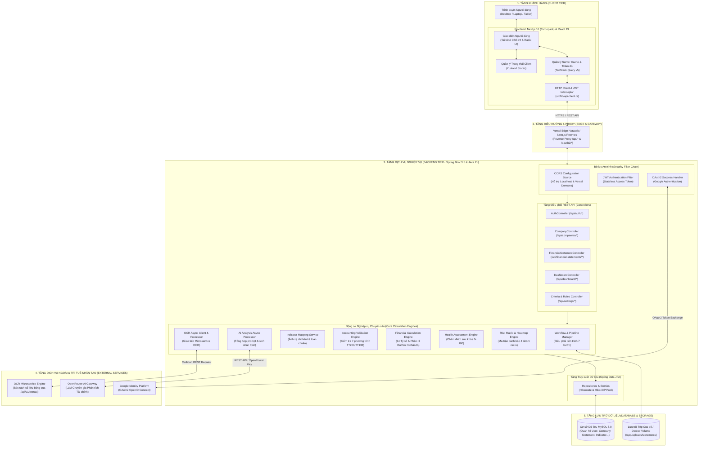
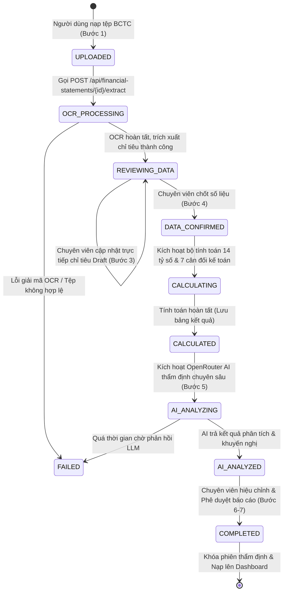

# HỆ THỐNG THẨM ĐỊNH & ĐÁNH GIÁ SỨC KHỎE TÀI CHÍNH DOANH NGHIỆP
## ENTERPRISE FINANCIAL HEALTH ASSESSMENT SYSTEM

[](https://openjdk.org/)
[](https://spring.io/projects/spring-boot)
[-000000?style=flat-square&logo=nextdotjs&logoColor=white)](https://nextjs.org/)
[](https://react.dev/)
[](https://www.typescriptlang.org/)
[](https://tailwindcss.com/)
[](https://www.mysql.com/)
[](http://localhost:8080/swagger-ui.html)

---

## 1. Giới thiệu Tổng quan (Overview)

**Hệ thống Thẩm định Sức khỏe Tài chính Doanh nghiệp (Financial System)** là nền tảng phân tích tài chính toàn diện, được thiết kế chuyên biệt theo Chuẩn mực Kế toán Việt Nam (**Thông tư 200/2014/TT-BTC** và **Thông tư 133/2016/TT-BTC**). 

Hệ thống tự động hóa toàn bộ quy trình từ khâu nạp Báo cáo Tài chính (BCTC dạng PDF/ảnh scan), ứng dụng công nghệ OCR bóc tách số liệu, đối soát trực quan, kiểm tra tính cân bằng kế toán, tính toán 14 tỷ số tài chính chuyên sâu, phân tích mô hình DuPont, cho đến đánh giá rủi ro và tổng hợp nhận định bằng AI.

### Triết lý & Nguyên tắc Cốt lõi (Core Principles)
1. **Zero Client-Side Calculation:** Tuyệt đối không tính toán chỉ số tài chính ở phía giao diện người dùng (Frontend). Mọi công thức tỷ số, kiểm tra cân bằng kế toán và ma trận rủi ro được tính toán độc quyền bởi `financial-be` sử dụng kiểu dữ liệu `BigDecimal` với độ chính xác cao (`RoundingMode.HALF_UP`).
2. **Session-Based Statement Analysis:** Mỗi tệp BCTC được nạp lên là một phiên thẩm định độc lập. Người dùng có thể chuyển đổi tức thì giữa các phiên BCTC qua dropdown ngay trên TopHeader để tái nạp toàn bộ Dashboard theo phiên đã chọn.
3. **Single Source of Truth:** TopHeader là vị trí duy nhất hiển thị Tên Doanh nghiệp & Mã số thuế (MST) và Bộ chọn phiên BCTC. Không lặp lại thông tin công ty ở Sidebar hay Khối 1 Dashboard.
4. **Color-Coded Risk Heatmap:** Ma trận rủi ro Khối 3C hiển thị giá trị số liệu ở trên, tên chỉ số ở dưới với mã màu trực quan (Xanh: An toàn, Vàng: Lưu ý, Đỏ: Cảnh báo), loại bỏ các nhãn chữ dư thừa.
5. **Forest Green Identity:** Toàn bộ giao diện tuân thủ bảng màu chuẩn nhận diện tài chính doanh nghiệp `#006c49` kết hợp phong cách thiết kế hiện đại, viền sắc nét, bo góc chuẩn mực.

---

## 2. Các Tính năng Nổi bật (Key Features)

### 2.1. Quy trình Phân tích 7 Bước Trực quan (7-Step Pipeline)
Thanh tiến trình 7 bước cố định cho phép thẩm định viên theo dõi và thao tác mạch lạc:
$$\text{[ 1 ] Tải lên} \longrightarrow \text{[ 2 ] OCR} \longrightarrow \text{[ 3 ] Rà soát} \longrightarrow \text{[ 4 ] Tính toán} \longrightarrow \text{[ 5 ] AI Đánh giá} \longrightarrow \text{[ 6 ] Hiệu chỉnh} \longrightarrow \text{[ 7 ] Lưu trữ}$$

* **Bước 1 - Tải lên (`/statements/pipeline`):** Kéo thả tệp BCTC (PDF / Scan tối đa 50MB). Hệ thống tự động nhận diện chuẩn mực (TT200/TT133) và niên độ kế toán qua OCR/AI mà không cần chọn thủ công.
* **Bước 2 - Bóc tách OCR:** Tự động nhận diện cấu trúc các bảng: Bảng Cân đối Kế toán, Báo cáo Kết quả Kinh doanh, Báo cáo Lưu chuyển Tiền tệ.
* **Bước 3 - Rà soát Số liệu:** Giao diện chia đôi màn hình (Split Screen) — tài liệu scan gốc bên trái, bảng chỉ tiêu trích xuất bên phải. Cho phép nhấp sửa trực tiếp dữ liệu thô (Draft Data).
* **Bước 4 - Tính toán & Kiểm tra Cân bằng:** Tự động kích hoạt bộ kiểm tra 7 phương trình cân đối kế toán và tính toán 14 tỷ số tài chính then chốt.
* **Bước 5 - Thẩm định AI:** AI chuyên gia phân tích tự động cơ cấu tài chính, điểm mạnh, rủi ro tiềm ẩn và đề xuất khuyến nghị.
* **Bước 6 - Hiệu chỉnh Nhận xét:** Thẩm định viên xem xét, biên tập và hoàn thiện nhận xét tài chính cuối cùng.
* **Bước 7 - Lưu trữ & Phê duyệt:** Khóa số liệu phiên BCTC, lưu vào kho dữ liệu doanh nghiệp và điều hướng về Dashboard tổng quan.

### 2.2. Dashboard Tổng quan Sức khỏe Tài chính (`/dashboard`)
* **Zero-Data State:** Tự động hiển thị vùng thả file (Upload Dropzone) trực tiếp ngay tại Dashboard nếu tài khoản chưa có dữ liệu BCTC nào.
* **TopHeader:** Tên Doanh nghiệp in đậm nổi bật, MST đặt gọn bên dưới, bộ chọn nhanh file BCTC đang phân tích và nút `+ Tải BCTC mới`.
* **Khối 1 - Header Tổng quan:** Điểm sức khỏe tài chính tổng hợp (0 - 100), phân loại trạng thái (AN TOÀN / LƯU Ý / CẢNH BÁO) kèm kỳ báo cáo và chuẩn mực kế toán.
* **Khối 2 - 4 Core KPI Cards:** Thanh toán hiện hành, Đòn bẩy nợ, Thanh toán nhanh, Tỷ suất ROE kèm thanh tiến độ trực quan.
* **Khối 3 - Ma trận Cảnh báo Rủi ro & Cân đối Kế toán:**
  * **Khối 3C (Risk Heatmap):** Ma trận 14 tỷ số phân nhóm theo Thanh khoản, Đòn bẩy, Hoạt động và Sinh lời. Hiển thị giá trị ở trên, tên chỉ số ở dưới, màu nền Xanh/Vàng/Đỏ theo ngưỡng an toàn.
  * **Khối 3D (Validation Balance):** Kiểm tra 7 phương trình cân bằng kế toán theo TT200/TT133 với trạng thái Đạt/Không đạt và dung sai cho phép.
* **Khối 4 - Phân tích Mô hình DuPont:** Cây phân rã ROE 3 bước (Biên Lợi Nhuận Ròng $\times$ Vòng Quay Tổng Tài Sản $\times$ Đòn Bẩy Tài Chính).
* **Khối 5 - Báo cáo Thẩm định AI:** Trình bày chi tiết nhận định tổng quát, cơ cấu tài chính, khuyến nghị và kết luận có xác nhận của thẩm định viên.

### 2.3. Quản lý Hồ sơ Doanh nghiệp (`/company`)
* Quản lý thông tin pháp nhân: Tên đầy đủ, tên viết tắt, MST, ngành nghề kinh doanh, địa chỉ, số điện thoại, email, website.
* Hỗ trợ 2 chế độ trực quan: **Xem chi tiết (View Mode)** và **Chỉnh sửa (Edit Mode)** cập nhật dữ liệu tức thì qua `PUT /api/companies/me`.

### 2.4. Tiêu chí & Quy tắc Tài chính (`/settings`)
* **Tiêu chí Đánh giá Tỷ số (Core KPIs):** Tùy biến ngưỡng an toàn (Green), cảnh báo (Yellow), và rủi ro (Red) cho 4 chỉ số cốt lõi qua `PUT /api/evaluation-criteria/{id}`.
* **Quy tắc Kiểm tra Kế toán (Validation Rules):** Cấu hình công thức 7 phương trình cân bằng TT200/TT133, sai số chấp nhận được (`tolerance`) và mức độ nghiêm trọng (`CRITICAL` / `WARNING`) qua `PUT /api/validation-rules/{id}`.

---

## 3. Sơ đồ Kiến trúc Hệ thống (System Architecture)

### 3.1. Kiến trúc Tổng thể Đa tầng (High-Level Multi-Tier Architecture)

Hệ thống được thiết kế theo mô hình **Phân tách Đa tầng (Multi-Tier Architecture)** kết hợp cấu trúc **Modular Monolith** ở Backend và **Server/Client Components** ở Frontend:



---

### 3.2. Sơ đồ Luồng Dữ liệu Quy trình Thẩm định 7 Bước (Data Flow Pipeline)

Toàn bộ chu trình thẩm định Báo cáo Tài chính diễn ra tuần tự với cơ chế đồng bộ trạng thái chặt chẽ giữa Client và Backend:

```mermaid
flowchart LR
    Step1["[ Bước 1 ]<br/>Tải lên Tệp<br/>(PDF / Ảnh Scan)"]
    Step2["[ Bước 2 ]<br/>Bóc tách OCR<br/>(Async Polling 2.5s)"]
    Step3["[ Bước 3 ]<br/>Rà soát Số liệu<br/>(Split-Screen)"]
    Step4["[ Bước 4 ]<br/>Tính toán & Cân đối<br/>(7 Equs & 14 Ratios)"]
    Step5["[ Bước 5 ]<br/>Thẩm định AI<br/>(Scoring & Commentary)"]
    Step6["[ Bước 6 ]<br/>Hiệu chỉnh<br/>(Review & Edit)"]
    Step7["[ Bước 7 ]<br/>Lưu trữ & Phê duyệt<br/>(Khóa phiên BCTC)"]
    Dashboard["Trung tâm Điều hành<br/>Dashboard 6 Khối"]

    Step1 -->|"Kích hoạt OCR ngầm"| Step2
    Step2 -->|"Tự động chuyển bước"| Step3
    Step3 -->|"Xác nhận chốt Draft"| Step4
    Step4 -->|"Kích hoạt Đánh giá & Rủi ro"| Step5
    Step5 -->|"Gợi ý nhận định chuyên gia"| Step6
    Step6 -->|"Chốt báo cáo cuối"| Step7
    Step7 -->|"Tái nạp toàn bộ dữ liệu"| Dashboard
```



---

### 3.3. Sơ đồ Máy Trạng thái Vòng đời BCTC (Statement State Machine)

Mỗi phiên BCTC được quản lý bởi một Máy trạng thái hữu hạn (Finite State Machine) nhằm đảm bảo tính toàn vẹn dữ liệu và khả năng khôi phục khi tải lại trang (F5 Resilience):



---

### 3.4. Bảng Diễn giải Luồng Giao tiếp giữa các Phân hệ

| Phân hệ Nguồn | Phân hệ Đích | Giao thức / Định dạng | Cơ chế Hoạt động | Mục đích |
| :--- | :--- | :--- | :--- | :--- |
| **Frontend (Next.js)** | **Backend (Spring Boot)** | HTTPS / REST / JSON | JWT Bearer Token, Axios Interceptors tự làm mới Token | Gửi yêu cầu thao tác người dùng, nạp dữ liệu bảng biểu, đồ thị |
| **Frontend (Next.js)** | **Vercel Edge Network** | HTTPS / Edge Rewrite | Proxy ngược `/api/*` và `/oauth2/*` về Backend URL | Tránh lỗi CORS và lỗi Private Network Access (PNA) |
| **Backend (Spring Boot)** | **OCR Microservice** | HTTP / Multipart Form-Data | Bất đồng bộ (`@Async`, `ThreadPoolTaskExecutor`) | Bóc tách tự động bảng cân đối kế toán, kết quả kinh doanh và lưu chuyển tiền tệ |
| **Backend (Spring Boot)** | **OpenRouter API** | HTTPS / REST / JSON | Spring `RestClient` với cơ chế Retry & Timeout 120s | Gửi dữ liệu tỷ số tài chính cho LLM phân tích, sinh nhận định điều hành |
| **Backend (Spring Boot)** | **MySQL Database** | TCP / JDBC (HikariCP) | ORM Spring Data JPA / Hibernate | Lưu trữ quan hệ: doanh nghiệp, phiên BCTC, chỉ tiêu thô, tỷ số, ma trận rủi ro |

---

## 4. Cấu trúc Dự án (Project Structure)

```
Financial_system/
├── .gitignore                      # Cấu hình Git Ignore toàn diện cho monorepo
├── README.md                       # Tài liệu tổng quan dự án (File này)
│
├── financial-be/                   # BACKEND: Spring Boot 3.5, Java 21
│   ├── src/main/java/com/financial/
│   │   ├── common/                 # Cấu hình dùng chung, bảo mật JWT, OCR Client, Exceptions
│   │   │   ├── config/             # SecurityConfig, CorsConfig, OpenApiConfig
│   │   │   ├── exception/          # GlobalExceptionHandler, Custom Exceptions
│   │   │   ├── ocr/                # OCR RestClient & DTOs
│   │   │   └── response/           # ApiResponse, PageResponse
│   │   └── modules/                # Các module nghiệp vụ theo chuẩn Domain-Driven Design
│   │       ├── auth/               # Đăng nhập, Đăng ký, Refresh Token, Google OAuth2
│   │       ├── user/               # Thực thể người dùng & phân quyền
│   │       ├── company/            # Hồ sơ doanh nghiệp & chuẩn mực kế toán
│   │       ├── financialstatement/ # Quản lý BCTC, Upload, Pipeline 7 bước
│   │       ├── financialindicator/ # Chỉ tiêu kế toán trích xuất từ OCR
│   │       ├── validation/         # Engine kiểm tra 7 phương trình cân bằng kế toán
│   │       ├── calculationengine/  # Engine tính toán 14 tỷ số tài chính & DuPont
│   │       ├── riskanalysis/       # Ma trận cảnh báo rủi ro (Risk Heatmap)
│   │       ├── assessment/         # Thẩm định sức khỏe & chấm điểm tổng hợp (0-100)
│   │       ├── aianalysis/         # Tích hợp OpenRouter LLM sinh nhận định
│   │       ├── dashboard/          # API tổng hợp Overview đa kỳ và theo phiên
│   │       └── evaluationcriteria/ # Cấu hình ngưỡng tỷ số & tiêu chí đánh giá
│   ├── src/main/resources/
│   │   └── application.properties  # Cấu hình Spring Boot (Database, JWT, OCR, AI)
│   ├── docs/                       # Tài liệu thiết kế API Backend & Frontend Integration
│   ├── .env.example                # Mẫu biến môi trường Backend
│   ├── .gitignore                  # Git Ignore Backend
│   └── pom.xml                     # Quản lý thư viện Maven
│
└── financial-fe/                   # FRONTEND: Next.js 16, React 19, TypeScript
    ├── src/
    │   ├── app/                    # Next.js App Router
    │   │   ├── (auth)/             # Route Đăng nhập, Đăng ký, Quên mật khẩu
    │   │   ├── (dashboard)/        # Layout chính có TopHeader & Sidebar
    │   │   │   ├── dashboard/      # Màn hình Dashboard tổng quan sức khỏe tài chính
    │   │   │   ├── statements/     # Danh sách & Quy trình 7 bước (/pipeline, /[id]/analysis)
    │   │   │   ├── company/        # Màn hình Xem/Sửa Hồ sơ Doanh nghiệp
    │   │   │   └── settings/       # Màn hình Cấu hình Tiêu chí & Quy tắc Tài chính
    │   │   └── onboarding/         # Màn hình thiết lập hồ sơ công ty lần đầu
    │   ├── components/             # Reusable UI Components
    │   │   ├── layout/             # TopHeader (Single Source of Truth), Sidebar
    │   │   └── ui/                 # Shadcn/Radix UI: button, card, input, dialog, badge...
    │   ├── features/               # Modules theo tính năng (Components, Services, Types)
    │   │   ├── dashboard/          # GlobalContextHeader, KPICards, RiskHeatmap, DuPontTree
    │   │   ├── statements/         # PipelineStepper, UploadDropzone, StatementTable
    │   │   ├── company/            # CompanyProfileForm, ViewMode, EditMode
    │   │   └── rules/              # EvaluationCriteriaEditor, ValidationRulesEditor
    │   ├── stores/                 # Zustand Global State
    │   │   ├── auth-store.ts       # Trạng thái đăng nhập & thông tin User
    │   │   ├── company-store.ts    # Doanh nghiệp hiện tại & đồng bộ thông tin
    │   │   └── statement-store.ts  # Phiên BCTC đang xem & danh sách BCTC
    │   └── lib/                    # Axios instance, API client, Helpers
    ├── docs/                       # Tài liệu thiết kế UI/UX & Session-Based Analysis
    ├── .env.example                # Mẫu biến môi trường Frontend
    ├── .gitignore                  # Git Ignore Frontend
    └── package.json                # Quản lý dependencies & scripts Node.js
```

---

## 5. Công nghệ Sử dụng (Tech Stack)

### Backend
* **Ngôn ngữ & Framework:** Java 21, Spring Boot 3.5.x
* **Bảo mật:** Spring Security 6, Stateless JWT (Access + Refresh Token), Google OAuth2
* **Cơ sở Dữ liệu & ORM:** MySQL 8.0, Spring Data JPA, Hibernate, HikariCP
* **Tài liệu API:** SpringDoc OpenAPI v2 (Swagger UI 3.0)
* **Giao tiếp Dịch vụ:** Spring `RestClient` kết nối OCR Microservice & OpenRouter AI
* **Tính toán Số học:** Java `BigDecimal` với scale và rounding mode chuẩn xác

### Frontend
* **Framework:** Next.js 16 (Turbopack, React Server Components, App Router)
* **Thư viện UI & Styling:** React 19, Tailwind CSS v4, Lucide React, Radix UI
* **Quản lý Trạng thái:** Zustand (Client Session & Store Persistence)
* **Xử lý Dữ liệu Máy chủ:** TanStack Query v5 (React Query)
* **Biểu mẫu & Xác thực:** React Hook Form, Zod Schema Validation
* **HTTP Client:** Axios với bộ interceptor tự động làm mới JWT token

---

## 6. Hướng dẫn Cài đặt & Khởi chạy (Getting Started)

### 6.1. Yêu cầu Tiên quyết (Prerequisites)
* **Java Development Kit (JDK):** Phiên bản 21 trở lên (khuyên dùng Eclipse Temurin 21 hoặc OpenJDK 21)
* **Node.js:** Phiên bản 18.18 trở lên (khuyên dùng Node 20 LTS)
* **Trình quản lý gói:** npm, pnpm hoặc yarn
* **Cơ sở dữ liệu:** MySQL Server 8.0+ đang hoạt động

---

### 6.2. Khởi chạy Backend (`financial-be`)

1. **Di chuyển vào thư mục backend:**
   ```bash
   cd financial-be
   ```

2. **Thiết lập biến môi trường:**
   Tạo file `.env` từ file mẫu `.env.example`:
   ```bash
   cp .env.example .env
   ```
   Cập nhật các thông số kết nối Database và Khóa bảo mật:
   ```env
   SERVER_PORT=8080
   DB_HOST=localhost
   DB_PORT=3306
   DB_NAME=financial_system
   DB_USERNAME=root
   DB_PASSWORD=your_password
   JWT_SECRET=your_super_secret_base64_jwt_key_here
   OPENROUTER_API_KEY=your_openrouter_api_key
   ```

3. **Biên dịch và khởi chạy Spring Boot:**
   * **Trên Windows (PowerShell/CMD):**
     ```powershell
     .\mvnw.cmd spring-boot:run
     ```
   * **Trên Linux/macOS:**
     ```bash
     chmod +x mvnw
     ./mvnw spring-boot:run
     ```

4. **Kiểm tra Backend:**
   * Máy chủ hoạt động tại: `http://localhost:8080`
   * Tài liệu Swagger UI tương tác: `http://localhost:8080/swagger-ui.html`
   * OpenAPI JSON Schema: `http://localhost:8080/v3/api-docs`

---

### 6.3. Khởi chạy Frontend (`financial-fe`)

1. **Di chuyển vào thư mục frontend:**
   ```bash
   cd financial-fe
   ```

2. **Cài đặt các gói phụ thuộc (Dependencies):**
   ```bash
   npm install
   ```

3. **Thiết lập biến môi trường:**
   Tạo file `.env.local` từ file mẫu `.env.example`:
   ```bash
   cp .env.example .env.local
   ```
   *(Mặc định `NEXT_PUBLIC_API_URL=http://localhost:8080` khi chạy local. Khi deploy lên Vercel, cấu hình `NEXT_PUBLIC_API_URL=https://financial-system-jc3a.onrender.com`).*

4. **Khởi chạy máy chủ phát triển:**
   ```bash
   npm run dev
   ```

5. **Truy cập Giao diện Ứng dụng:**
   * Mở trình duyệt tại: `http://localhost:3000`
   * Đăng ký tài khoản mới hoặc đăng nhập để bắt đầu trải nghiệm.

---

## 7. Danh mục API Endpoints Chính (Core API Endpoints)

| Phân hệ | Phương thức | Đường dẫn API | Mô tả chức năng |
| :--- | :--- | :--- | :--- |
| **Xác thực** | `POST` | `/api/auth/register` | Đăng ký tài khoản người dùng mới |
| | `POST` | `/api/auth/login` | Đăng nhập hệ thống & nhận JWT Access/Refresh Token |
| | `POST` | `/api/auth/refresh` | Cấp mới Access Token bằng Refresh Token |
| **Doanh nghiệp** | `GET` | `/api/companies/me` | Lấy thông tin hồ sơ doanh nghiệp của người dùng hiện tại |
| | `POST` | `/api/companies` | Khởi tạo hồ sơ công ty lần đầu (Onboarding) |
| | `PUT` | `/api/companies/me` | Cập nhật thông tin hồ sơ doanh nghiệp |
| **Báo cáo Tài chính** | `GET` | `/api/financial-statements` | Danh sách các tệp BCTC đã nạp (có phân trang & lọc) |
| | `POST` | `/api/financial-statements/upload` | Nạp tệp BCTC mới (PDF/Scan) khởi tạo Pipeline 7 bước |
| | `GET` | `/api/financial-statements/{id}` | Chi tiết thông tin BCTC và trạng thái tiến trình |
| | `GET` | `/api/financial-statements/{id}/indicators` | Danh sách chỉ tiêu kế toán trích xuất từ OCR |
| | `PUT` | `/api/financial-statements/{id}/indicators/bulk` | Lưu và chốt số liệu sau khi chuyên viên đối soát (Bước 3) |
| **Tính toán & Rủi ro** | `POST` | `/api/financial-statements/{id}/calculate` | Kích hoạt engine tính 14 tỷ số tài chính (Bước 4) |
| | `POST` | `/api/financial-statements/{id}/validate` | Kích hoạt kiểm tra 7 phương trình cân bằng TT200/TT133 |
| | `POST` | `/api/financial-statements/{id}/ai-analysis` | Gọi AI sinh báo cáo nhận định chuyên sâu (Bước 5) |
| **Dashboard** | `GET` | `/api/dashboard/overview` | Lấy dữ liệu tổng quan Khối 1-5 theo phiên `financialStatementId` |
| **Cấu hình Tiêu chí** | `GET` | `/api/evaluation-criteria` | Danh sách ngưỡng an toàn/cảnh báo của 4 Core KPIs |
| | `PUT` | `/api/evaluation-criteria/{id}` | Cập nhật ngưỡng đánh giá chỉ số tài chính |
| **Quy tắc Cân bằng** | `GET` | `/api/validation-rules` | Danh sách 7 quy tắc cân bằng kế toán TT200/TT133 |
| | `PUT` | `/api/validation-rules/{id}` | Cập nhật công thức cân đối, dung sai sai số và mức độ nghiêm trọng |

---

## 8. Tài liệu Kỹ thuật Chi tiết (Documentation)

Hệ thống đi kèm bộ tài liệu đặc tả kỹ thuật chi tiết đặt tại thư mục `docs/`:
* 📘 [Tài liệu Tích hợp API Frontend (`FRONTEND_INTEGRATION_GUIDE.md`)](financial-be/docs/FRONTEND_INTEGRATION_GUIDE.md)
* 📐 [Đặc tả Thiết kế API Swagger OpenAPI 3.0 (`SWAGGER_API_DESIGN.md`)](financial-be/docs/SWAGGER_API_DESIGN.md)
* 🎯 [Đặc tả Kiến trúc Thẩm định theo Phiên (`SESSION_BASED_ANALYSIS_SPEC.md`)](financial-fe/docs/SESSION_BASED_ANALYSIS_SPEC.md)
* 🎨 [Quy chuẩn Thiết kế Giao diện UI/UX & Design Tokens (`UI_UX_DESIGN_SPEC.md`)](financial-fe/docs/UI_UX_DESIGN_SPEC.md)

---

## 9. Bảo mật & Quy ước Đóng góp (Security & Guidelines)

* **Bảo vệ Bí mật (Secrets Management):** Không bao giờ đưa file `.env` hoặc các khóa bí mật (`JWT_SECRET`, mật khẩu Database, `OPENROUTER_API_KEY`) lên Git repository. File `.gitignore` ở thư mục gốc và thư mục con đã được cấu hình chặt chẽ để ngăn chặn rò rỉ thông tin.
* **Nguyên tắc Tính toán:** Tuyệt đối không thực hiện bất kỳ phép tính tỷ số tài chính hay logic kiểm tra cân bằng nào tại Frontend. Tất cả phải được ủy quyền xử lý từ Backend.
* **Cập nhật Mẫu Biến môi trường:** Khi bổ sung biến cấu hình mới, luôn cập nhật file `.env.example` tương ứng tại `financial-be/` và `financial-fe/`.

---

## 10. Bản quyền & Thông tin Dự án (License & Credits)

* **Dự án:** Hệ thống Đánh giá Sức khỏe Tài chính Doanh nghiệp (Financial Health Assessment System)
* **Học phần:** Công nghệ Tài chính (FinTech)
* **Năm thực hiện:** 2026
* **Mã nguồn:** Mở phục vụ mục đích nghiên cứu và học tập.

