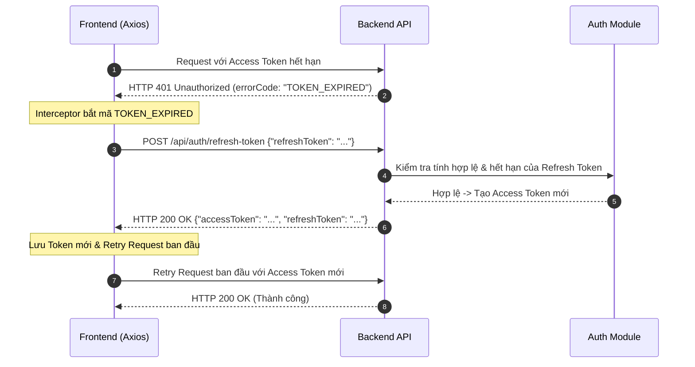
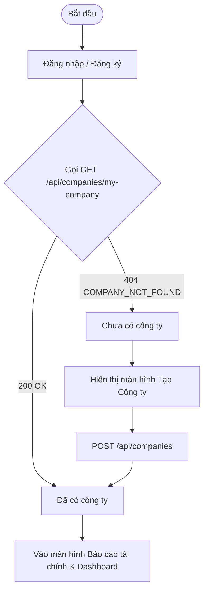
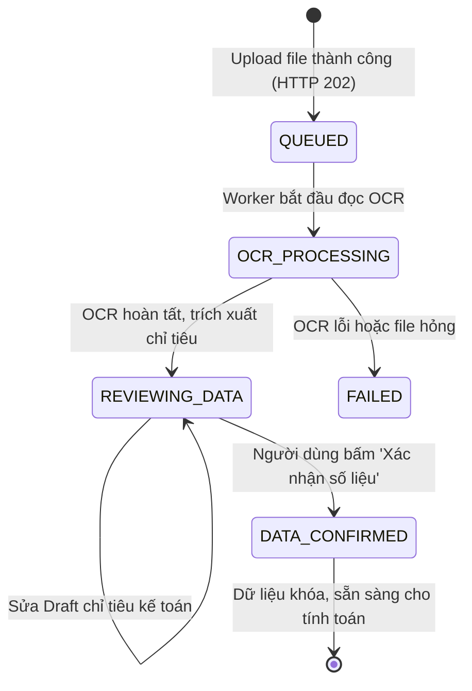
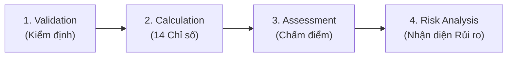

# TÀI LIỆU KỸ THUẬT TÍCH HỢP FRONTEND (FRONTEND INTEGRATION GUIDE)
**Dự án:** Hệ thống Đánh giá Sức khỏe Tài chính Doanh nghiệp (Enterprise Financial Health Assessment System - `financial-be`)  
**Phiên bản Backend:** 1.0.0 (Java 17, Spring Boot 4.x, Modular Monolith)  
**Ngày cập nhật:** 01/11/2026  

---

## MỤC LỤC
1. [Tổng quan Kiến trúc & Chuẩn giao tiếp API](#1-tổng-quan-kiến-trúc--chuẩn-giao-tiếp-api)
   - [1.1. Môi trường & Base URL](#11-môi-trường--base-url)
   - [1.2. Cấu trúc Response chuẩn (ApiResponse Envelope)](#12-cấu-trúc-response-chuẩn-apiresponse-envelope)
   - [1.3. Cơ chế Phân trang chuẩn (PageResponse)](#13-cơ-chế-phân-trang-chuẩn-pageresponse)
   - [1.4. Cơ chế Xác thực JWT & Tự động Refresh Token](#14-cơ-chế-xác-thực-jwt--tự-động-refresh-token)
2. [Luồng Khởi tạo & Định danh Doanh nghiệp (Onboarding Flow)](#2-luồng-khởi-tạo--định-danh-doanh-nghiệp-onboarding-flow)
   - [2.1. Đăng ký & Đăng nhập](#21-đăng-ký--đăng-nhập)
   - [2.2. Khai báo & Quản lý Thông tin Công ty](#22-khai-báo--quản-lý-thông-tin-công-ty)
3. [Vòng đời Báo cáo Tài chính & Tích hợp OCR (Financial Statement Lifecycle)](#3-vòng-đời-báo-cáo-tài-chính--tích-hợp-ocr-financial-statement-lifecycle)
   - [3.1. Máy trạng thái BCTC (Statement State Machine)](#31-máy-trạng-thái-bctc-statement-state-machine)
   - [3.2. Bước 1: Upload File BCTC](#32-bước-1-upload-file-bctc)
   - [3.3. Bước 2: Polling trạng thái xử lý OCR](#33-bước-2-polling-trạng-thái-xử-lý-ocr)
   - [3.4. Bước 3: Xem và Chỉnh sửa Số liệu Draft](#34-bước-3-xem-và-chỉnh-sửa-số-liệu-draft)
   - [3.5. Bước 4: Xác nhận Chốt Số liệu (Confirm)](#35-bước-4-xác-nhận-chốt-số-liệu-confirm)
4. [Chuỗi Kích hoạt Pipeline Phân tích Chuyên sâu (Analysis Pipeline)](#4-chuỗi-kích-hoạt-pipeline-phân-tích-chuyên-sâu-analysis-pipeline)
   - [4.1. Kiểm định Kế toán (Validation Engine)](#41-kiểm-định-kế-toán-validation-engine)
   - [4.2. Tính toán 14 Chỉ số Tài chính (Calculation Engine)](#42-tính-toán-14-chỉ-số-tài-chính-calculation-engine)
   - [4.3. Đánh giá & Chấm điểm Sức khỏe (Health Assessment)](#43-đánh-giá--chấm-điểm-sức-khỏe-health-assessment)
   - [4.4. Nhận diện Rủi ro Tài chính (Risk Analysis)](#44-nhận-diện-rủi-ro-tài-chính-risk-analysis)
5. [Phân hệ Phân tích AI & Tương tác Phê duyệt (AI Analysis & Review)](#5-phân-hệ-phân-tích-ai--tương-tác-phê-duyệt-ai-analysis--review)
   - [5.1. Kích hoạt Phân tích Bất đồng bộ & Polling](#51-kích-hoạt-phân-tích-bất-đồng-bộ--polling)
   - [5.2. Hiển thị 5 khối Nhận định Chuyên gia AI](#52-hiển-thị-5-khối-nhận-định-chuyên-gia-ai)
   - [5.3. Người dùng Hiệu chỉnh (Final Comment) & Phê duyệt / Từ chối](#53-người-dùng-hiệu-chỉnh-final-comment--phê-duyệt--từ-chối)
6. [Trung tâm Điều hành Dashboard & Trực quan hóa (Visual Analytics)](#6-trung-tâm-điều-hành-dashboard--trực-quan-hóa-visual-analytics)
   - [6.1. API Dashboard Tổng thể (Dashboard Overview)](#61-api-dashboard-tổng-thể-dashboard-overview)
   - [6.2. 4 Thẻ Core KPI Scoreboard](#62-4-thẻ-core-kpi-scoreboard)
   - [6.3. Bảng 14 Chỉ số Tài chính Phân loại 4 Nhóm](#63-bảng-14-chỉ-số-tài-chính-phân-loại-4-nhóm)
   - [6.4. Mô hình Dữ liệu Vẽ Biểu đồ (Cơ cấu vốn & So sánh ngưỡng)](#64-mô-hình-dữ-liệu-vẽ-biểu-đồ-cơ-cấu-vốn--so-sánh-ngưỡng)
   - [6.5. Biểu đồ Xu hướng Đa kỳ (Trends API)](#65-biểu-đồ-xu-hướng-đa-kỳ-trends-api)
7. [Sổ tay Mã lỗi & Hướng dẫn Trạng thái Rỗng (Error Handling & Empty States)](#7-sổ-tay-mã-lỗi--hướng-dẫn-trạng-thái-rỗng-error-handling--empty-states)
   - [7.1. Bảng Tra cứu Mã lỗi Global (Error Code Reference)](#71-bảng-tra-cứu-mã-lỗi-global-error-code-reference)
   - [7.2. Ma trận Trạng thái Rỗng & Gợi ý UX (Empty States Matrix)](#72-ma-trận-trạng-thái-rỗng--gợi-ý-ux-empty-states-matrix)
8. [Phụ lục: TypeScript Interfaces Mẫu](#8-phụ-lục-typescript-interfaces-mẫu)

---

## 1. TỔNG QUAN KIẾN TRÚC & CHUẨN GIAO TIẾP API

### 1.1. Môi trường & Base URL
* **Development:** `http://localhost:8080`
* **Production:** Được cung cấp theo cấu hình hạ tầng triển khai.
* **OpenAPI / Swagger UI:** `http://localhost:8080/swagger-ui.html`
* **OpenAPI JSON Spec:** `http://localhost:8080/v3/api-docs`

Tất cả các endpoint kinh doanh đều bắt đầu bằng tiền tố `/api/...`.

---

### 1.2. Cấu trúc Response chuẩn (ApiResponse Envelope)
Toàn bộ phản hồi từ backend (dù thành công hay thất bại) đều được bọc trong cấu trúc chuẩn:

```typescript
interface ApiResponse<T> {
  success: boolean;        // true nếu thành công, false nếu có lỗi
  message: string;         // Thông điệp phản hồi bằng tiếng Việt hoặc Anh
  data?: T;                // Dữ liệu payload nghiệp vụ (null nếu thất bại)
  errorCode?: string;      // Mã định danh lỗi chuẩn (chỉ xuất hiện khi success = false)
  timestamp: string;       // Thời gian phản hồi ISO-8601 (VD: 2026-11-01T14:30:00)
}
```

#### Ví dụ Response Thành công:
```json
{
  "success": true,
  "message": "Dashboard overview retrieved successfully",
  "data": { ... },
  "timestamp": "2026-11-01T14:30:00.123"
}
```

#### Ví dụ Response Lỗi:
```json
{
  "success": false,
  "errorCode": "STATEMENT_NOT_FOUND",
  "message": "Financial statement not found with ID: 99 for your company.",
  "timestamp": "2026-11-01T14:30:01.456"
}
```

---

### 1.3. Cơ chế Phân trang chuẩn (PageResponse)
Các API trả về danh sách có phân trang sử dụng cấu trúc `PageResponse<T>` nằm bên trong trường `data`:

```typescript
interface PageResponse<T> {
  content: T[];            // Mảng các phần tử của trang hiện tại
  pageNumber: number;      // Chỉ số trang hiện tại (0-indexed)
  pageSize: number;        // Kích thước trang
  totalElements: number;   // Tổng số phần tử trên toàn bộ hệ thống
  totalPages: number;      // Tổng số trang
  isLast: boolean;         // Có phải trang cuối cùng không
  isFirst: boolean;        // Có phải trang đầu tiên không
  isEmpty: boolean;        // Trang có rỗng không
}
```

---

### 1.4. Cơ chế Xác thực JWT & Tự động Refresh Token

Hệ thống áp dụng mô hình bảo mật **Single User Role**:
* Mỗi người dùng chỉ có một vai trò tiêu chuẩn, có toàn quyền quản lý dữ liệu thuộc phạm vi Doanh nghiệp của chính mình.
* Backend xác định danh tính thông qua JWT Bearer Token gửi trong Header:
  ```http
  Authorization: Bearer <accessToken>
  ```

#### Sơ đồ Tuần tự Refresh Token Tự động (Axios Interceptor):



> [!IMPORTANT]
> **Quy tắc cho Frontend:**
> 1. Lưu `accessToken` vào Memory hoặc Cookie bảo mật; lưu `refreshToken` vào Cookie `HttpOnly` hoặc LocalStorage được mã hóa.
> 2. Nếu refresh token cũng thất bại (HTTP `401` với `INVALID_REFRESH_TOKEN` hoặc `REFRESH_TOKEN_EXPIRED`), điều hướng người dùng về trang Đăng nhập (`/login`).

---

## 2. LUỒNG KHỞI TẠO & ĐỊNH DANH DOANH NGHIỆP (ONBOARDING FLOW)



### 2.1. Đăng ký & Đăng nhập
* **Đăng ký tài khoản:** `POST /api/auth/register`
  ```json
  {
    "fullName": "Nguyễn Văn A",
    "email": "analyst@company.com",
    "password": "Password@123"
  }
  ```
* **Đăng nhập:** `POST /api/auth/login`
  ```json
  {
    "email": "analyst@company.com",
    "password": "Password@123"
  }
  ```
  *Response data:* Chứa `accessToken`, `refreshToken`, `user: { id, email, fullName }`.

---

### 2.2. Khai báo & Quản lý Thông tin Công ty
* **Quy tắc cốt lõi:** Mỗi User chỉ được tạo và sở hữu **DUY NHẤT 1** công ty.
* **Lấy thông tin công ty của tôi:** `GET /api/companies/my-company`
  - Nếu trả về `200 OK`: Lưu `company` vào global state.
  - Nếu trả về `404` (`COMPANY_NOT_FOUND`): Bắt buộc hiển thị Form khởi tạo công ty.
* **Tạo mới công ty:** `POST /api/companies`
  ```json
  {
    "companyName": "Công ty Cổ phần Công nghệ ABC",
    "taxCode": "0101234567",
    "mainBusinessLine": "Công nghệ thông tin",
    "address": "Số 1 Đại Cồ Việt, Hai Bà Trưng, Hà Nội",
    "phoneNumber": "02412345678",
    "email": "contact@abc.vn"
  }
  ```
  *Lỗi thường gặp:* Mã số thuế trùng lặp (`409 TAX_CODE_ALREADY_EXISTS`), User đã có công ty (`409 COMPANY_ALREADY_EXISTS`).

---

## 3. VÒNG ĐỜI BÁO CÁO TÀI CHÍNH & TÍCH HỢP OCR

### 3.1. Máy trạng thái BCTC (Statement State Machine)



---

### 3.2. Bước 1: Upload File BCTC
Frontend cung cấp form chọn file và thông tin kỳ kế toán:
* **Endpoint:** `POST /api/financial-statements/upload`
* **Content-Type:** `multipart/form-data`
* **Form fields:**
  - `file`: File BCTC dạng Binary (`.pdf`, `.png`, `.jpg`, `.jpeg`, `.tiff`). Giới hạn tối đa **50MB**.
  - `period`: Kỳ báo cáo (VD: `"2024"`, `"Q3-2024"`).
  - `standard`: Chuẩn mực kế toán (VD: `"TT200"`, `"TT133"`, `"TT99"`).
  - `fiscalYear`: Năm tài chính (VD: `2024`).
* **Phản hồi:** Trả về HTTP `202 Accepted` ngay lập tức:
  ```json
  {
    "success": true,
    "message": "Financial statement has been received and queued for processing.",
    "data": {
      "id": 10,
      "status": "QUEUED"
    }
  }
  ```

---

### 3.3. Bước 2: Polling trạng thái xử lý OCR
Do OCR tài liệu tài chính nhiều trang có thể mất từ vài giây đến tối đa 10 phút, Frontend cần thiết lập bộ đếm Polling:
* **Endpoint kiểm tra trạng thái:** `GET /api/financial-statements/{id}/status`
* **Chu kỳ Polling khuyến nghị:** `2.500 ms` (2.5 giây/lần).
* **Xử lý theo trạng thái:**
  - `QUEUED` / `OCR_PROCESSING`: Tiếp tục hiển thị Loading Spinner / Thanh tiến trình.
  - `REVIEWING_DATA`: Dừng Polling. Chuyển hướng người dùng sang **Màn hình Review số liệu trích xuất**.
  - `FAILED`: Dừng Polling. Hiển thị thông báo lỗi từ `errorMessage` (VD: File scan quá mờ, không tìm thấy bảng cân đối...).

---

### 3.4. Bước 3: Xem và Chỉnh sửa Số liệu Draft
Sau khi OCR xong, các dòng chỉ tiêu kế toán được lưu tạm để người dùng đối soát:
* **Lấy danh sách các dòng chỉ tiêu:** `GET /api/financial-statements/{id}/items`
  *Mỗi phần tử trả về gồm:*
  - `id`: ID dòng chỉ tiêu.
  - `code`: Mã số kế toán (VD: `"270"` - Tổng tài sản, `"300"` - Nợ phải trả, `"400"` - Vốn CSH).
  - `label`: Tên chỉ tiêu chuẩn hóa tiếng Việt.
  - `rawLabel`: Nhãn gốc trích xuất từ OCR.
  - `currentValue`: Giá trị số dư kỳ này.
  - `previousValue`: Giá trị số dư kỳ trước.
  - `mappingStatus`: Trạng thái ánh xạ (`MAPPED`, `UNMAPPED`, `AMBIGUOUS`).
  - `draft`: Thông tin chỉnh sửa chưa xác nhận (nếu có).

* **Người dùng chỉnh sửa số liệu từng dòng:** `PUT /api/financial-statements/{id}/items/{itemId}/draft`
  ```json
  {
    "currentValue": 10500000000,
    "previousValue": 9800000000,
    "note": "Điều chỉnh theo biên bản kiểm toán độc lập"
  }
  ```

---

### 3.5. Bước 4: Xác nhận Chốt Số liệu (Confirm)
Khi kế toán/chuyên viên tài chính đã kiểm tra xong các số liệu:
* **Endpoint:** `POST /api/financial-statements/{id}/confirm`
* **Tác động:**
  - Áp dụng toàn bộ số liệu draft vào số liệu chính thức.
  - Đưa trạng thái BCTC sang `DATA_CONFIRMED`.
  - Khóa chỉnh sửa để đảm bảo tính toàn vẹn số liệu cho các engine phân tích phía sau.

> [!WARNING]
> Mọi tính toán chỉ số, chấm điểm sức khỏe và phân tích rủi ro chỉ hợp lệ khi BCTC ở trạng thái `DATA_CONFIRMED`. Nếu gọi tính toán trên BCTC chưa xác nhận, backend sẽ chặn bằng mã lỗi `UNCONFIRMED_STATEMENT` (400).

---

## 4. CHUỖI KÍCH HOẠT PIPELINE PHÂN TÍCH CHUYÊN SÂU

Frontend có thể hiển thị nút bấm "Kích hoạt phân tích toàn diện" hoặc thực hiện tự động gọi chuỗi 4 bước sau khi người dùng Confirm BCTC thành công:



### 4.1. Kiểm định Kế toán (Validation Engine)
* **Kích hoạt kiểm định:** `POST /api/validations/statements/{statementId}`
* **Lấy kết quả mới nhất:** `GET /api/validations/statements/{statementId}/latest`
* **Mô hình DTO kết quả:**
  - `overallStatus`: `PASS` (Hợp lệ), `WARNING` (Có cảnh báo lệch nhẹ), `FAIL` (Sai lệch phương trình cân đối).
  - `results`: Mảng các vi phạm. Lưu ý hiển thị icon màu theo `severity`:
    - `CRITICAL` (Đỏ đậm): Sai lệch phương trình Tổng tài sản $\neq$ Nợ + Vốn CSH.
    - `HIGH` / `MEDIUM` (Cam/Vàng): Biến động bất thường, chỉ tiêu bị âm không hợp lý.
    - `LOW` / `INFO` (Xanh/Xám): Lưu ý định dạng.

---

### 4.2. Tính toán 14 Chỉ số Tài chính (Calculation Engine)
* **Kích hoạt tính toán:** `POST /api/calculations/statements/{statementId}`
* **Lấy kết quả mới nhất:** `GET /api/calculations/statements/{statementId}/latest`
* **14 Chỉ số tài chính được hệ thống tính toán tự động:**
  1. **Thanh khoản (Liquidity):** `CURRENT_RATIO`, `QUICK_RATIO`, `CASH_RATIO`.
  2. **Đòn bẩy & Nợ (Solvency):** `DEBT_TO_EQUITY`, `DEBT_RATIO`, `EQUITY_RATIO`.
  3. **Hiệu suất sinh lời (Profitability):** `ROA`, `ROE`, `NET_PROFIT_MARGIN`, `GROSS_PROFIT_MARGIN`.
  4. **Hiệu quả hoạt động (Efficiency):** `ASSET_TURNOVER`, `INVENTORY_TURNOVER`, `RECEIVABLES_TURNOVER`, `PAYABLES_TURNOVER`.

---

### 4.3. Đánh giá & Chấm điểm Sức khỏe (Health Assessment)
* **Kích hoạt chấm điểm:** `POST /api/assessments/statements/{statementId}`
* **Lấy kết quả mới nhất:** `GET /api/assessments/statements/{statementId}/latest`
* **Dữ liệu hiển thị:**
  - `overallScore`: Điểm sức khỏe tổng thể (thang 100).
  - `healthClassification`: Xếp hạng doanh nghiệp (VD: `EXCELLENT`, `GOOD`, `MODERATE`, `VULNERABLE`, `CRITICAL`).
  - `details`: So sánh từng chỉ số với ngưỡng cấu hình kèm trạng thái `evaluationStatus` (`PASS`, `FAIL`, `NOT_CONFIGURED`).

---

### 4.4. Nhận diện Rủi ro Tài chính (Risk Analysis)
* **Kích hoạt phân tích rủi ro:** `POST /api/risk-analyses/statements/{statementId}`
* **Lấy kết quả mới nhất:** `GET /api/risk-analyses/statements/{statementId}/latest`
* **Dữ liệu hiển thị:**
  - `summary`: Số lượng rủi ro theo từng mức độ `lowRisks`, `mediumRisks`, `highRisks`, `criticalRisks`.
  - `identifiedRisks`: Danh sách các rủi ro phát hiện kèm tiêu đề, diễn giải, bằng chứng (`actualValue` vs `thresholdValue`) và khuyến nghị khắc phục.

---

## 5. PHÂN HỆ PHÂN TÍCH AI & TƯƠNG TÁC PHÊ DUYỆT

Phân hệ sử dụng AI Gateway (OpenRouter) để tổng hợp toàn bộ kết quả từ 4 phân hệ trên thành bản nhận định tài chính chuyên nghiệp bằng tiếng Việt.

### 5.1. Kích hoạt Phân tích Bất đồng bộ & Polling
* **Endpoint kích hoạt:** `POST /api/ai-analyses/assessments/{assessmentId}/generate`
* **Phản hồi:** Trả về HTTP `202 Accepted` ngay lập tức:
  ```json
  {
    "success": true,
    "message": "AI analysis generation initiated",
    "data": {
      "id": 1,
      "status": "PENDING"
    }
  }
  ```
* **Cơ chế Polling:** Định kỳ gọi `GET /api/ai-analyses/{id}` mỗi 2.5 giây cho đến khi:
  - `status === "COMPLETED"`: Dừng Polling và hiển thị giao diện báo cáo AI.
  - `status === "FAILED"`: Dừng Polling và thông báo lý do (`errorMessage`).

---

### 5.2. Hiển thị 5 khối Nhận định Chuyên gia AI
Khi phân tích hoàn tất, giao diện hiển thị 5 khối nội dung rõ ràng:
1. **Executive Summary (Tóm tắt điều hành):** Khái quát tình trạng tài chính tổng thể.
2. **Strengths (Điểm mạnh tài chính):** Danh sách các điểm sáng kèm dẫn chứng chỉ số cụ thể.
3. **Risks (Rủi ro cảnh báo):** Các nguy cơ mất cân đối thanh khoản hoặc rủi ro nợ vay.
4. **Recommendations (Khuyến nghị hành động):** Các giải pháp chiến lược kèm mức độ ưu tiên (`HIGH`, `MEDIUM`, `LOW`).
5. **Limitations (Hạn chế dữ liệu):** Cảnh báo nếu có chỉ số thiếu dữ liệu BCTC hoặc chưa cấu hình ngưỡng.

---

### 5.3. Người dùng Hiệu chỉnh (Final Comment) & Phê duyệt / Từ chối

Backend phân định rành mạch giữa 2 trường:
* `aiGeneratedComment`: Chuỗi nhận định gốc từ AI (hoàn toàn **bất biến**, lưu để đối soát và kiểm toán).
* `finalComment`: Nội dung hiển thị cuối cùng mà người dùng có quyền chỉnh sửa.

#### Các API Tương tác:
* **Chỉnh sửa bình luận:** `PUT /api/ai-analyses/{id}/final-comment`
  ```json
  {
    "finalComment": "Doanh nghiệp có cơ cấu tài chính ổn định, tuy nhiên ban điều hành cần ưu tiên thu hồi công nợ tồn đọng trong Quý 4."
  }
  ```
  *(Trạng thái review sẽ tự động đổi sang `EDITED`).*
* **Phê duyệt báo cáo:** `POST /api/ai-analyses/{id}/approve` $\rightarrow$ Trạng thái chuyển thành `APPROVED`.
* **Từ chối báo cáo:** `POST /api/ai-analyses/{id}/reject` $\rightarrow$ Trạng thái chuyển thành `REJECTED`.

---

## 6. TRUNG TÂM ĐIỀU HÀNH DASHBOARD & TRỰC QUAN HÓA

Để tối ưu trải nghiệm và giảm tải số lượng request từ client, phân hệ Dashboard cung cấp các API gom cụm dữ liệu phục vụ render trọn vẹn màn hình chính.

### 6.1. API Dashboard Tổng thể (Dashboard Overview)
* **Endpoint:** `GET /api/dashboard/overview`
* **Query Parameters (Tùy chọn):**
  - `period`: Kỳ báo cáo cần xem (VD: `?period=2024`). Nếu bỏ trống, hệ thống tự động chọn BCTC đã xác nhận mới nhất.
  - `financialStatementId`: ID BCTC chỉ định (có kiểm tra quyền sở hữu).

#### Cấu trúc Phản hồi Tổng quan:
```json
{
  "success": true,
  "data": {
    "context": {
      "companyId": 1,
      "companyName": "Công ty Cổ phần Công nghệ ABC",
      "taxCode": "0101234567",
      "businessSector": "Công nghệ thông tin",
      "accountingStandard": "TT200",
      "selectedPeriod": "2024",
      "currencyUnit": "VND",
      "financialStatementId": 10,
      "financialStatementProcessingStatus": "DATA_CONFIRMED",
      "hasCompany": true,
      "hasFinancialStatement": true,
      "dataStatus": "READY"
    },
    "dataStatuses": {
      "companyStatus": "READY",
      "statementStatus": "READY",
      "calculationStatus": "READY",
      "validationStatus": "READY",
      "assessmentStatus": "READY",
      "riskStatus": "READY",
      "aiStatus": "READY"
    },
    "coreKpis": [ ... ],
    "financialRatios": [ ... ],
    "visualAnalytics": { ... },
    "validation": { ... },
    "riskOverview": { ... },
    "aiCommentary": { ... }
  }
}
```

---

### 6.2. 4 Thẻ Core KPI Scoreboard
Nằm trong `data.coreKpis` hoặc gọi riêng qua `GET /api/dashboard/kpis`:

| Mã KPI | Tên hiển thị | Ngưỡng tiêu chuẩn | Toán tử | Ý nghĩa tài chính |
|---|---|---:|:---:|---|
| `CURRENT_RATIO` | Khả năng thanh toán hiện hành | 1.50 | `>=` | Đo lường năng lực trả nợ ngắn hạn |
| `DEBT_TO_EQUITY` | Hệ số nợ / Vốn CSH | 1.00 | `<=` | Mức độ an toàn đòn bẩy tài chính |
| `ROA` | Tỷ suất sinh lời trên tổng tài sản | 5.0% | `>=` | Hiệu quả sử dụng tài sản tạo lợi nhuận |
| `ROE` | Tỷ suất sinh lời trên vốn CSH | 12.0% | `>=` | Khả năng sinh lời cho cổ đông |

* **Quy ước màu thẻ KPI trên UI:**
  - Xanh lục (`PASS`): Giá trị đạt hoặc vượt ngưỡng tiêu chí.
  - Đỏ/Cam (`FAIL`): Giá trị không đạt ngưỡng an toàn.
  - Xám (`NOT_CONFIGURED` / `CALCULATION_NOT_AVAILABLE`): Chưa cài đặt ngưỡng hoặc thiếu số liệu.

---

### 6.3. Bảng 14 Chỉ số Tài chính Phân loại 4 Nhóm
Nằm trong `data.financialRatios` hoặc gọi riêng qua `GET /api/dashboard/financial-ratios`:

Frontend tổ chức hiển thị dạng **Tabs** hoặc **Accordion** gồm 4 nhóm:
1. `LIQUIDITY` (Thanh khoản): `CURRENT_RATIO`, `QUICK_RATIO`, `CASH_RATIO`.
2. `SOLVENCY` (Đòn bẩy & Nợ): `DEBT_TO_EQUITY`, `DEBT_RATIO`, `EQUITY_RATIO`.
3. `PROFITABILITY` (Hiệu suất sinh lời): `ROA`, `ROE`, `NET_PROFIT_MARGIN`, `GROSS_PROFIT_MARGIN`.
4. `EFFICIENCY` (Hiệu quả hoạt động): `ASSET_TURNOVER`, `INVENTORY_TURNOVER`, `RECEIVABLES_TURNOVER`, `PAYABLES_TURNOVER`.

---

### 6.4. Mô hình Dữ liệu Vẽ Biểu đồ (Cơ cấu vốn & So sánh ngưỡng)
Nằm trong `data.visualAnalytics` hoặc gọi riêng qua `GET /api/dashboard/visual-analytics`:

#### A. Biểu đồ Cơ cấu Vốn (Capital Structure - Pie/Donut Chart)
* **Dữ liệu:**
  ```json
  "capitalStructure": {
    "totalAssets": 10000000000,
    "totalLiabilities": 4000000000,
    "equity": 6000000000,
    "debtRatio": 0.4000,
    "equityRatio": 0.6000,
    "unit": "VND"
  }
  ```
* **Frontend Chart:** Render biểu đồ tròn thể hiện tỷ trọng Nợ phải trả (40%) và Vốn chủ sở hữu (60%) trên Tổng tài sản.

#### B. Biểu đồ So sánh Ngưỡng (Ratio Comparison - Bar Chart)
* **Dữ liệu:** Mỗi phần tử trong `ratioComparisons` chứa:
  - `ratioCode`, `ratioName`
  - `actualValue`: Giá trị thực tế của doanh nghiệp.
  - `configuredThreshold`: Ngưỡng đánh giá đã cấu hình.
  - `industryBenchmark`: Luôn là `null` (kèm `benchmarkStatus: "NOT_CONFIGURED"`). Tuyệt đối **không** gán nhãn ngưỡng tiêu chí là benchmark ngành.

---

### 6.5. Biểu đồ Xu hướng Đa kỳ (Trends API)
* **Endpoint:** `GET /api/dashboard/trends`
* **Query Parameters:**
  - `fromPeriod`: Kỳ bắt đầu (VD: `2022`).
  - `toPeriod`: Kỳ kết thúc (VD: `2024`).
  - `ratioCodes`: Danh sách mã chỉ số cần vẽ (VD: `CURRENT_RATIO,DEBT_TO_EQUITY,ROA,ROE`). Nếu bỏ trống, mặc định lấy 4 core KPIs.
* **Mẫu Response:**
  ```json
  {
    "companyId": 1,
    "companyName": "Công ty Cổ phần ABC",
    "availablePeriods": ["2022", "2023", "2024"],
    "trendData": [
      {
        "reportingPeriod": "2022",
        "ratioCode": "CURRENT_RATIO",
        "value": 1.6500,
        "unit": "TIMES"
      },
      {
        "reportingPeriod": "2023",
        "ratioCode": "CURRENT_RATIO",
        "value": 1.7200,
        "unit": "TIMES"
      },
      {
        "reportingPeriod": "2024",
        "ratioCode": "CURRENT_RATIO",
        "value": 1.8500,
        "unit": "TIMES"
      }
    ]
  }
  ```
* **Frontend Chart:** Render biểu đồ đường đa kỳ (Multi-line Chart) với trục X là `reportingPeriod` và trục Y là `value`.

---

## 7. SỔ TAY MÃ LỖI & HƯỚNG DẪN TRẠNG THÁI RỖNG

### 7.1. Bảng Tra cứu Mã lỗi Global (Error Code Reference)

| HTTP Status | Mã Lỗi (`errorCode`) | Ý nghĩa nghiệp vụ | Hướng xử lý đề xuất cho Frontend UI |
|:---:|---|---|---|
| **400** | `INVALID_INPUT` / `VALIDATION_FAILED` | Dữ liệu form không hợp lệ | Hiển thị lỗi validation màu đỏ dưới từng input field |
| **400** | `UNCONFIRMED_STATEMENT` | BCTC chưa chốt số liệu | Điều hướng/nhắc người dùng bấm Confirm BCTC trước |
| **400** | `INVALID_FILE_TYPE` | Định dạng file không hỗ trợ | Báo lỗi: "Chỉ hỗ trợ file PDF, PNG, JPG, TIFF" |
| **400** | `FILE_TOO_LARGE` | File vượt quá 50MB | Báo lỗi: "Kích thước file không được vượt quá 50MB" |
| **401** | `TOKEN_EXPIRED` | Access Token hết hạn | Gọi `/api/auth/refresh-token` để lấy token mới |
| **401** | `UNAUTHORIZED` | Chưa đăng nhập hoặc token sai | Đưa người dùng về màn hình `/login` |
| **404** | `COMPANY_NOT_FOUND` | Người dùng chưa có công ty | Mở popup/màn hình Khởi tạo thông tin Doanh nghiệp |
| **404** | `STATEMENT_NOT_FOUND` | Không tìm thấy BCTC chỉ định | Thông báo Toast: "Báo cáo tài chính không tồn tại" |
| **404** | `ASSESSMENT_NOT_FOUND` | Chưa thực hiện chấm điểm | Nhắc người dùng kích hoạt chuỗi tính toán |
| **409** | `TAX_CODE_ALREADY_EXISTS` | Mã số thuế đã có trên hệ thống | Báo lỗi tại trường Mã số thuế |
| **409** | `COMPANY_ALREADY_EXISTS` | Tài khoản đã sở hữu 1 công ty | Ẩn nút tạo mới, chỉ cho phép chỉnh sửa |
| **409** | `CONCURRENT_AI_ANALYSIS` | AI đang chạy cho đợt này | Báo Toast: "Đang có tiến trình phân tích AI đang xử lý" |
| **502** | `OPENROUTER_API_ERROR` | Lỗi từ AI Provider OpenRouter | Thông báo: "Dịch vụ AI tạm thời gián đoạn, vui lòng thử lại sau" |
| **504** | `OPENROUTER_TIMEOUT` | AI xử lý quá 120s | Thông báo: "Quá thời gian phản hồi từ AI, vui lòng thử lại" |
| **504** | `OCR_TIMEOUT` | OCR xử lý quá 600s | Thông báo: "Tài liệu quét quá lâu, vui lòng kiểm tra lại chất lượng scan" |

---

### 7.2. Ma trận Trạng thái Rỗng & Gợi ý UX (Empty States Matrix)

Frontend dựa vào trường `dataStatus` hoặc các cờ boolean để hiển thị giao diện phù hợp, tránh màn hình trắng:

| Giá trị `dataStatus` | Hoàn cảnh kích hoạt | Hành vi UI/UX được khuyến nghị |
|---|---|---|
| `NO_COMPANY` | User mới đăng ký, chưa tạo công ty | Hiển thị màn hình chào mừng (Onboarding Empty State) với nút bấm lớn: **"Khai báo Doanh nghiệp ngay"**. |
| `NO_FINANCIAL_STATEMENT` | Đã có công ty nhưng chưa upload BCTC nào | Hiển thị Banner/Dropzone lớn: **"Tải lên Báo cáo tài chính đầu tiên của bạn"**. |
| `STATEMENT_NOT_CONFIRMED` | BCTC mới OCR xong, đang ở trạng thái `REVIEWING_DATA` | Ẩn toàn bộ thẻ KPI/Biểu đồ chính thức. Hiển thị thông báo màu vàng: **"Báo cáo tài chính đang chờ đối soát. Vui lòng xác nhận số liệu để kích hoạt Dashboard"** kèm nút dẫn sang trang Review. |
| `CALCULATION_NOT_AVAILABLE` | BCTC đã confirm nhưng chưa chạy Calculation | Hiển thị thẻ KPI với giá trị `--` (không hiển thị số `0`). Cung cấp nút bấm: **"Kích hoạt Tính toán chỉ số"**. |
| `NOT_CONFIGURED` | Chỉ số chưa được cài đặt tiêu chuẩn đánh giá | Hiển thị badge xám **"Chưa cấu hình tiêu chí"** tại cột Ngưỡng và Đánh giá. Tuyệt đối không thay thế bằng giá trị `0`. |
| `EMPTY_TRENDS` | Không có đủ BCTC qua các kỳ để vẽ xu hướng | Hiển thị biểu đồ rỗng (Empty Chart Placeholder) với thông điệp: **"Cần ít nhất 2 kỳ BCTC đã chốt số liệu để xem xu hướng biến động"**. |

---

## 8. PHỤ LỤC: TYPESCRIPT INTERFACES MẪU

Lập trình viên Frontend có thể sao chép trực tiếp các khai báo Type/Interface sau vào thư mục `src/types/api.d.ts` hoặc `src/types/financial.ts`:

```typescript
// 1. Envelopes
export interface ApiResponse<T> {
  success: boolean;
  message: string;
  data?: T;
  errorCode?: string;
  timestamp: string;
}

export interface PageResponse<T> {
  content: T[];
  pageNumber: number;
  pageSize: number;
  totalElements: number;
  totalPages: number;
  isLast: boolean;
  isFirst: boolean;
  isEmpty: boolean;
}

// 2. Dashboard Context
export interface DashboardContext {
  companyId: number;
  companyName: string;
  taxCode: string;
  businessSector: string;
  accountingStandard: string;
  selectedPeriod: string;
  currencyUnit: string;
  financialStatementId: number;
  financialStatementProcessingStatus: string;
  hasCompany: boolean;
  hasFinancialStatement: boolean;
  dataStatus: string;
}

// 3. Core KPI & Financial Ratio
export interface DashboardKPI {
  code: string;
  name: string;
  value: number | null;
  unit: string | null;
  calculationStatus: string;
  evaluationStatus: string;
  configuredThreshold: number | null;
  comparisonOperator: string | null;
  explanation: string | null;
}

export interface DashboardRatio {
  code: string;
  name: string;
  category: 'LIQUIDITY' | 'SOLVENCY' | 'PROFITABILITY' | 'EFFICIENCY';
  categoryDisplayName: string;
  value: number | null;
  unit: string | null;
  calculationStatus: string;
  evaluationStatus: string;
  threshold: number | null;
  comparisonOperator: string | null;
  missingDataExplanation: string | null;
}

export interface DashboardCategory {
  category: string;
  displayName: string;
  ratios: DashboardRatio[];
}

// 4. Visual Analytics
export interface CapitalStructure {
  totalAssets: number | null;
  totalLiabilities: number | null;
  equity: number | null;
  unit: string;
  debtRatio: number | null;
  equityRatio: number | null;
}

export interface RatioComparison {
  ratioCode: string;
  ratioName: string;
  category: string;
  actualValue: number | null;
  unit: string | null;
  configuredThreshold: number | null;
  comparisonOperator: string | null;
  evaluationStatus: string;
  industryBenchmark: number | null;
  benchmarkStatus: string;
}

export interface VisualAnalytics {
  ratioComparisons: RatioComparison[];
  capitalStructure: CapitalStructure | null;
  categoryOverview: DashboardCategory[];
}

// 5. Validation Overview
export interface ValidationResultItem {
  ruleCode: string;
  ruleName: string;
  category: string;
  status: 'PASS' | 'WARNING' | 'FAIL' | 'NOT_APPLICABLE' | 'REVIEW_REQUIRED' | 'ERROR';
  severity: 'INFO' | 'LOW' | 'MEDIUM' | 'HIGH' | 'CRITICAL';
  expectedValue: number | null;
  actualValue: number | null;
  differenceValue: number | null;
  explanation: string;
  sourcePages: string;
  affectedIndicators: string;
}

export interface DashboardValidation {
  validationId: number | null;
  overallStatus: string;
  accountingStandard: string | null;
  totalRules: number;
  passedRules: number;
  warningRules: number;
  failedRules: number;
  reviewRequiredRules: number;
  errorRules: number;
  notApplicableRules: number;
  executedAt: string | null;
  results: ValidationResultItem[];
}

// 6. Risk Overview
export interface DashboardIdentifiedRisk {
  riskId: number;
  category: string;
  title: string;
  description: string;
  severity: 'LOW' | 'MEDIUM' | 'HIGH' | 'CRITICAL';
  status: 'DETECTED' | 'MONITORING' | 'RESOLVED' | 'NOT_CONFIGURED' | 'INSUFFICIENT_DATA';
  evidence: string;
  relatedRatioCode: string;
  actualValue: number | null;
  thresholdValue: number | null;
  recommendation: string;
}

export interface DashboardRiskResponse {
  riskAnalysisId: number | null;
  executionStatus: string;
  summary: {
    totalRisks: number;
    lowRisks: number;
    mediumRisks: number;
    highRisks: number;
    criticalRisks: number;
    resolvedRisks: number;
    notConfiguredCount: number;
    insufficientDataCount: number;
  };
  identifiedRisks: DashboardIdentifiedRisk[];
}

// 7. AI Commentary
export interface AIStrength {
  title: string;
  description: string;
  evidence: string[];
}

export interface AIRisk {
  title: string;
  description: string;
  severity: string;
  category: string;
  evidence: string[];
  sourceRiskId: number | null;
}

export interface AIRecommendation {
  title: string;
  description: string;
  priority: 'LOW' | 'MEDIUM' | 'HIGH' | 'CRITICAL';
  relatedRiskId: string | null;
}

export interface DashboardAICommentary {
  analysisId: number | null;
  executiveSummary: string | null;
  strengths: AIStrength[];
  risks: AIRisk[];
  recommendations: AIRecommendation[];
  limitations: string[];
  aiGenerationStatus: string;
  reviewStatus: 'PENDING' | 'APPROVED' | 'EDITED' | 'REJECTED' | 'NOT_AVAILABLE';
  aiGeneratedComment: string | null;
  finalComment: string | null;
  generatedAt: string | null;
  completedAt: string | null;
}

// 8. Trends
export interface TrendDataPoint {
  reportingPeriod: string;
  financialStatementId: number;
  calculationId: number;
  ratioCode: string;
  ratioName: string;
  category: string;
  value: number | null;
  unit: string;
  calculationStatus: string;
}

export interface DashboardTrendResponse {
  companyId: number;
  companyName: string;
  availablePeriods: string[];
  trendData: TrendDataPoint[];
}
```

