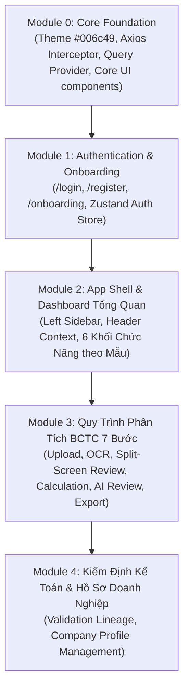

# TÀI LIỆU ĐẶC TẢ THIẾT KẾ GIAO DIỆN & TRẢI NGHIỆM NGƯỜI DÙNG (UI/UX DESIGN SPECIFICATION)
**Dự án:** Hệ thống Đánh giá Sức khỏe Tài chính Doanh nghiệp (Enterprise Financial Health Assessment System - `financial-fe`)  
**Phiên bản:** 1.0.0  
**Ngày phê duyệt:** 01/11/2026  
**Trạng thái:** Đã chốt qua quy trình Brainstorming (Design Locked & Approved)

---

## 1. TỔNG QUAN DỰ ÁN & HIỂU BIẾT HỆ THỐNG (UNDERSTANDING SUMMARY)

* **Tên dự án:** `financial-fe` (Frontend cho hệ thống `financial-be`).
* **Framework & Công nghệ cốt lõi:** Next.js 16 (App Router), React 19, TypeScript strict mode, Tailwind CSS v4, shadcn/ui, Lucide React, Recharts, TanStack Query v5, Axios, Zustand, React Hook Form, Zod.
* **Mục đích:** Tự động hóa và chuẩn hóa toàn diện chu trình thẩm định Báo cáo Tài chính (BCTC): từ nạp tài liệu scan/PDF, bóc tách OCR, đối soát số liệu kế toán, chạy bộ tính toán 14 chỉ số tài chính, chấm điểm xếp hạng, nhận diện rủi ro đến tổng hợp nhận định AI và xuất báo cáo điều hành.
* **Đối tượng người dùng chính:** Chuyên viên phân tích tài chính, kiểm toán viên, chuyên viên thẩm định tín dụng ngân hàng và quỹ đầu tư (yêu cầu mật độ thông tin cao, thao tác bàn phím nhanh, đối chiếu số liệu nguồn chuẩn xác).
* **Kiến trúc giao diện tổng thể:** **Phương án 1 (Modular Enterprise FinTech Shell với Split Stepper Pipeline)**.
  - Menu bên trái (Left Sidebar) cố định hỗ trợ thu gọn/mở rộng.
  - Thanh Stepper 7 chặng trực quan ở đầu trang theo URL `/statements/[id]/analysis?step=[1-7]`.
  - Không gian làm việc chia đôi (Split-Screen Workspace 50/50) ở các khâu đối soát tài liệu gốc và biên tập nhận định AI.
* **Nguyên tắc kỹ thuật bất biến:**
  - Tuyệt đối **không** tự tính toán tài chính trên frontend; toàn bộ chỉ số, tỷ số, điểm số do backend Spring Boot tính toán.
  - Quản lý phiên làm việc theo URL-driven state, tự động khôi phục đúng bước từ Backend State Machine khi tải lại trang (F5).
  - Tự động xoay vòng Access Token (15 phút) thông qua Refresh Token (7 ngày) bằng Axios Interceptor.

---

## 2. GIẢ ĐỊNH KỸ THUẬT & QUẢN TRỊ RỦI RO (ASSUMPTIONS & RISKS)

1. **Độ phân giải tối ưu:** Tối ưu hóa cho màn hình máy tính để bàn/laptop ($\ge 1280\text{px}$). Trên màn hình nhỏ hơn (< 1024px), giao diện Split-Screen tự động chuyển sang dạng Tabs chuyển đổi hoặc Stack dọc để đảm bảo khả năng đọc bảng biểu kế toán.
2. **Khôi phục phiên làm việc (Session Resilience):** Tác vụ OCR (tối đa vài phút) và AI Generation (10–60s) là bất đồng bộ. Dữ liệu trạng thái luôn được đồng bộ qua Polling 2.5s và lưu vết tại máy trạng thái backend (`QUEUED` $\rightarrow$ `OCR_PROCESSING` $\rightarrow$ `REVIEWING_DATA` $\rightarrow$ `DATA_CONFIRMED`). F5 không làm mất tiến trình.
3. **Quy tắc Single Company Onboarding:** Mỗi người dùng gắn với 1 công ty (`GET /api/companies/my-company`). Nếu trả về 404, hệ thống chặn điều hướng và yêu cầu hoàn tất màn hình Khởi tạo Doanh nghiệp (`/onboarding`).
4. **Định dạng xuất báo cáo tiếng Việt:** Tệp CSV xuất ra phải được nhúng **UTF-8 BOM (`\uFEFF`)** để mở trên Microsoft Excel mà không bị lỗi font tiếng Việt. Báo cáo PDF được định dạng in chuẩn khổ A4 ngang hoặc dọc 1 trang điều hành.

---

## 3. NHẬT KÝ QUYẾT ĐỊNH THIẾT KẾ (DECISION LOG)

| STT | Vấn đề quyết định | Các phương án đã cân nhắc | Quyết định chốt | Lý do lựa chọn |
|:---:|---|---|---|---|
| **01** | Đối tượng người dùng mục tiêu | A: Chuyên viên phân tích/Thẩm định tín dụng<br>B: Giám đốc tài chính (CFO)<br>C: Multi-role | **Phương án A (Chuyên viên thẩm định)** | Cần mật độ thông tin cao, bảng biểu nhiều kỳ, đối chiếu dữ liệu gốc và kiểm tra rủi ro tức thì. |
| **02** | Kiến trúc Điều hướng | A: Contextual Workspace<br>B: Flat Sidebar<br>C: Split-Pane Telemetry | **Left Sidebar + Pipeline 7 bước** | Mạch lạc, tách bạch giữa quản trị tổng thể (Dashboard) và quy trình thẩm định sâu từng BCTC. |
| **03** | Không gian làm việc tại khâu đối soát | A: Split-Screen View 50/50<br>B: Full-width + Drawer trượt<br>C: Accordion cuộn dài | **Phương án A (Split-Screen View)** | Chuyên viên vừa xem file PDF/Scan gốc vừa soát bảng chỉ tiêu hoặc xem nhận định AI mà không phải chuyển tab. |
| **04** | Cơ chế Lưu vết & Khôi phục phiên | A: URL-driven & Backend state<br>B: LocalStorage draft<br>C: In-memory session | **Phương án A (URL-driven State)** | Đảm bảo an toàn dữ liệu, chống mất việc khi F5 hoặc rớt mạng giữa lúc OCR/AI đang xử lý ngầm. |
| **05** | Kiến trúc giao diện tổng thể | 1: Modular FinTech Shell<br>2: Continuous Scrolling Dossier<br>3: Multi-Tab Floating Window | **Phương án 1 (Modular FinTech Shell)** | Cân bằng hoàn hảo giữa thẩm mỹ, khả năng mở rộng module, hiệu năng DOM và độ tin cậy vận hành. |
| **06** | Màn hình Dashboard | Thiết kế tùy biến vs Mẫu Vinamilk | **Chuẩn hóa theo ảnh mẫu Vinamilk** | Đầy đủ 6 khối chức năng đạt chuẩn ngân hàng: Context Header, 4 Core KPIs, Grouped Bar, Donut, Heatmap 14 tỷ số, Checklist TT200, AI Card, Action Bar. |

---

## 4. HỆ THỐNG DESIGN SYSTEM & DESIGN TOKENS

### 4.1. Bảng màu thương hiệu FinTech (`#006c49`)
```css
:root {
  /* Màu nhận diện thương hiệu chủ đạo */
  --primary: #006c49;                    /* Forest Green ngân hàng */
  --primary-foreground: #ffffff;
  --primary-hover: #00563a;
  --primary-light: #e6f3ee;

  /* Bề mặt & Nền */
  --background: #ffffff;
  --foreground: #0f172a;                 /* Slate 900 */
  --card: #ffffff;
  --card-foreground: #0f172a;
  --muted: #f8fafc;                      /* Slate 50 */
  --muted-foreground: #64748b;           /* Slate 500 */
  --border: #e2e8f0;                     /* Slate 200 */
  --ring: #006c49;

  /* Trạng thái đánh giá tài chính */
  --status-safe: #10b981;                /* Emerald 500 - An toàn / PASS */
  --status-safe-bg: #ecfdf5;
  --status-safe-border: #a7f3d0;
  --status-warning: #f59e0b;             /* Amber 500 - Lưu ý / WARNING */
  --status-warning-bg: #fffbeb;
  --status-warning-border: #fde68a;
  --status-danger: #ef4444;              /* Rose 500 - Nguy hiểm / FAIL */
  --status-danger-bg: #fef2f2;
  --status-danger-border: #fecaca;

  /* Bo góc & Đổ bóng */
  --radius: 0.75rem;                     /* rounded-xl = 12px */
  --shadow-subtle: 0 1px 3px 0 rgb(0 0 0 / 0.05);
}
```

### 4.2. Typography
- **Font gia đình:** `GeistSans`, `Inter` hoặc hệ thống Sans-Serif chuẩn quốc tế.
- **Phân cấp font:**
  - Header chính: `text-xl` hoặc `text-2xl`, `font-bold`, tracking tight.
  - KPI Hero Numbers: `text-3xl` hoặc `text-4xl`, `font-extrabold`.
  - Body / Table cells: `text-xs` hoặc `text-sm`, `font-medium`, tối ưu hiển thị số liệu dạng tabular (`font-mono` cho số tiền).

---

## 5. ĐẶC TẢ CHI TIẾT CÁC PHÂN HỆ GIAO DIỆN

### 5.1. Phân hệ Xác thực & Khởi tạo (Authentication & Onboarding)

#### Màn hình Đăng nhập (`/login`) & Đăng ký (`/register`)
- **Bố cục:** Chia đôi màn hình (50/50 Canvas).
  - *Cột trái:* Nền màu thương hiệu `#006c49`, họa tiết đồ họa lưới tài chính, logo và 3 trụ cột giá trị (OCR Bóc tách, Kiểm định TT200, Trợ lý AI).
  - *Cột phải:* Khung Card trắng `rounded-xl` chứa form:
    - Đăng nhập: Email, Mật khẩu (nút ẩn/hiện), Ghi nhớ đăng nhập, nút "Đăng nhập Google".
    - Đăng ký: Họ tên, Email, Mật khẩu (thanh đo độ mạnh mật khẩu theo Zod).
- **Cơ chế Token ngầm:** Axios Interceptor tự động bắt mã `TOKEN_EXPIRED` (HTTP 401) để gọi `/api/auth/refresh` và retry request trong suốt.

#### Màn hình Khởi tạo Doanh nghiệp (`/onboarding`)
- **Luồng chặn (Onboarding Gate):** Sau khi đăng nhập, nếu `GET /api/companies/my-company` trả về 404, lập tức chuyển hướng sang `/onboarding`.
- **Form khai báo (`POST /api/companies`):**
  - Tên doanh nghiệp đầy đủ, Mã số thuế, Ngành nghề kinh doanh chính, Địa chỉ trụ sở, Điện thoại, Email liên hệ.
  - Xử lý thông báo lỗi trùng lặp mã số thuế (`409 TAX_CODE_ALREADY_EXISTS`).

---

### 5.2. Khung Ứng Dụng Chính (App Shell Layout)
- **Menu bên trái (Left Sidebar) cố định:**
  - Header Sidebar: Logo hệ thống + Tên ứng dụng *"Financial Health"*.
  - Nhóm Menu chính:
    1. **Dashboard:** Biểu tượng `LayoutDashboard` $\rightarrow$ Trung tâm điều hành tổng quan.
    2. **Phân tích BCTC:** Biểu tượng `FileSpreadsheet` $\rightarrow$ Không gian làm việc quy trình 7 bước.
    3. **Hồ sơ Doanh nghiệp:** Biểu tượng `Building2` $\rightarrow$ Thông tin công ty & cấu hình chuẩn mực kế toán.
    4. **Tiêu chí & Quy tắc:** Biểu tượng `SlidersHorizontal` $\rightarrow$ Cấu hình ngưỡng chỉ số & quy tắc cảnh báo.
  - Chân Sidebar: Thông tin người dùng thu nhỏ, nút đổi mật khẩu, nút Đăng xuất.
- **Top Header Bar cố định:**
  - Hiển thị Breadcrumb vị trí hiện tại.
  - Huy hiệu ngữ cảnh: `{COMPANY_NAME}`, `{TAX_CODE}`, Kỳ BCTC đang chọn.
  - Chuông thông báo & Dropdown Profile người dùng.

---

### 5.3. Trung Tâm Điều Hành Dashboard (Chi Tiết 6 Khối Theo Ảnh Mẫu)

```
┌────────────────────────────────────────────────────────────────────────────────────────┐
│ KHỐI 1: HEADER NGỮ CẢNH TOÀN CỤC (#006c49)  |  [ĐÁNH GIÁ: AN TOÀN (88/100)] (Badge)    │
│ CÔNG TY CỔ PHẦN SỮA VIỆT NAM (VINAMILK) - DASHBOARD TỔNG QUAN SỨC KHỎE TÀI CHÍNH       │
│ Mã CK: VNM | MST: 0300588569 | Kỳ: 31/12/2025 | Chuẩn mực: TT200 | Nguồn: BCTC.pdf      │
└────────────────────────────────────────────────────────────────────────────────────────┘
┌───────────────────┬───────────────────┬───────────────────┬────────────────────────────┐
│ KHỐI 2: 4 CORE KPIS                                                                    │
│ Thanh toán hiện hành│ Nợ / VCSH (D/E)   │ ROA               │ ROE                        │
│ 1.96x  [AN TOÀN]  │ 0.55x [AN TOÀN]   │ 9.24% [AN TOÀN]   │ 18.50% [AN TOÀN]           │
│ ▰▰▰▰▰▰▰▰▱▱ (Gauge)│ ▰▰▰▰▱▱▱▱▱▱ (Gauge)│ ▰▰▰▰▰▰▰▱▱▱ (Gauge)│ ▰▰▰▰▰▰▰▰▰▱ (Gauge)        │
└───────────────────┴───────────────────┴───────────────────┴────────────────────────────┘
┌───────────────────────────────────────────────┬────────────────────────────────────────┐
│ KHỐI 3A: SO SÁNH 8 TỶ SỐ VS NGƯỠNG NGÀNH      │ KHỐI 3B: CƠ CẤU NGUỒN VỐN (TT200)      │
│ (Grouped Bar Chart: Thực tế vs An toàn ngành) │ (Donut Chart: Vốn CSH 65% vs Nợ 35%)   │
├───────────────────────────────────────────────┼────────────────────────────────────────┤
│ KHỐI 3C: MA TRẬN NHẬN DIỆN RỦI RO 14 TỶ SỐ    │ KHỐI 4: KIỂM ĐỊNH ĐẲNG THỨC [7/7 PASS] │
│ (Color-coded Heatmap: Xanh/Vàng-Cam/Đỏ)       │ Checklist 7 phương trình cân đối TT200 │
│ Thanh khoản | Cơ cấu Vốn | Sinh lời | Hoạt động│ Hiển thị số tiền lệch (Mục tiêu 0 VND) │
└───────────────────────────────────────────────┴────────────────────────────────────────┘
┌────────────────────────────────────────────────────────────────────────────────────────┐
│ KHỐI 5: NHẬN ĐỊNH CHUYÊN SÂU TỪ AI (OPENROUTER / CLAUDE 3.5 SONNET GATEWAY)            │
│ • Tóm tắt điều hành: Khái quát nền tảng tài chính tổng thể                             │
│ • Điểm mạnh cốt lõi: Nêu các chỉ số vượt trội và tính hợp lệ kế toán                   │
│ • Cảnh báo & Khuyến nghị: Cảnh báo chu kỳ tồn kho, giải phóng dòng tiền lưu chuyển     │
└────────────────────────────────────────────────────────────────────────────────────────┘
┌────────────────────────────────────────────────────────────────────────────────────────┐
│ KHỐI 6: THANH TÁC VỤ & ACTION BAR                                                      │
│ [✏️ Hiệu chỉnh số liệu]      [📥 Tải JSON]      [📊 Tải CSV (UTF-8)]      [📄 Xuất PDF] │
└────────────────────────────────────────────────────────────────────────────────────────┘
```

1. **Khối 1: Thông tin Ngữ cảnh & Doanh nghiệp (Global Context Header)**
   - Thanh banner màu `#006c49` bo góc `rounded-xl`.
   - Tiêu đề in hoa đậm: `{COMPANY_NAME} - DASHBOARD TỔNG QUAN SỨC KHỎE TÀI CHÍNH`.
   - Dòng phụ: Mã CK/MST, Kỳ BCTC, Chuẩn mực kế toán, Tên file nguồn gốc.
   - Badge xếp hạng góc phải: `ĐÁNH GIÁ: AN TOÀN (88/100)` màu xanh ngọc lục bảo.
   - Bộ lọc chuyển đổi xem báo cáo đơn kỳ hoặc bật chế độ xem đa năm.
2. **Khối 2: Bảng 4 KPI Tài chính Sống còn (Core KPI Scoreboard)**
   - 4 Card bo góc `rounded-xl` trắng nổi bật:
     - `CURRENT_RATIO`: Giá trị (VD: `1.96x`), Badge `AN TOÀN`, Chỉ tiêu $\ge 1.50x$, Progress Gauge.
     - `DEBT_TO_EQUITY`: Giá trị (VD: `0.55x`), Badge `AN TOÀN`, Chỉ tiêu $\le 1.00x$, Progress Gauge.
     - `ROA`: Giá trị (VD: `9.24%`), Badge `AN TOÀN`, Chỉ tiêu $\ge 5.00\%$, Progress Gauge.
     - `ROE`: Giá trị (VD: `18.50%`), Badge `AN TOÀN`, Chỉ tiêu $\ge 12.00\%$, Progress Gauge.
3. **Khối 3: Phân tích Đồ họa Trực quan & Ma trận 14 Tỷ số (Visual Analytics)**
   - **Khối 3A (Grouped Bar Chart):** So sánh 8 chỉ số trọng yếu giữa giá trị thực tế doanh nghiệp (cột xanh đậm `#006c49`) và ngưỡng an toàn ngành (cột xanh nhạt).
   - **Khối 3B (Capital Structure Donut Chart):** Biểu đồ tròn thể hiện tỷ trọng Nguồn vốn theo chuẩn B01-DN: Vốn CSH (VD: 65%) vs Nợ phải trả (VD: 35%).
   - **Khối 3C (Color-Coded Risk Heatmap):** Ma trận 4 hàng x 4 cột tương ứng 4 nhóm chỉ số (Thanh khoản, Cơ cấu vốn, Sinh lời, Hiệu quả vận hành). Mỗi ô hiển thị tên chỉ số, giá trị thực tế và tô màu theo mức độ an toàn (Xanh: An toàn; Vàng/Cam: Lưu ý; Đỏ: Rủi ro cao).
4. **Khối 4: Kiểm định Cân đối Kế toán TT200 (Validation Checklist)**
   - Huy hiệu tổng kết: `7/7 PASSED`.
   - Bảng 7 đẳng thức cân đối kế toán:
     1. $TS = Nguồn\ vốn\ (MS\ 270 = 440)$ – Khớp 100% (Lệch 0 VND).
     2. $TS\ ngắn\ hạn + Dài\ hạn = Tổng\ TS$ – Khớp 100% (Lệch 0 VND).
     3. $Nợ\ phải\ trả + VCSH = Nguồn\ vốn$ – Khớp 100% (Lệch 0 VND).
     4. $DTT = Doanh\ thu - Giảm\ trừ$ – Khớp 100% (Lệch 0 VND).
     5. $LNTT = LN\ thuần + LN\ khác$ – Khớp 100% (Lệch 0 VND).
     6. $LNST = LNTT - Chi\ phí\ thuế$ – Khớp 100% (Lệch 0 VND).
     7. $Lưu\ chuyển\ tiền\ tệ\ cân\ đối$ – Khớp 100% (Lệch 0 VND).
   - Tích hợp nút *"Xem trang gốc"* mở pop-up đối soát nhanh đến trang PDF scan chứa số liệu.
5. **Khối 5: Diễn giải AI & Ma trận Rủi ro Chuyên sâu (AI Executive Commentary)**
   - Hộp nhận định viền xanh lá tinh tế, tự động gọi qua OpenRouter API:
     - *Tóm tắt điều hành (Executive Summary):* Đánh giá khái quát tình hình tài chính.
     - *Điểm mạnh cốt lõi:* Nêu rõ các tỷ số vượt trội và tính hợp lệ kiểm định.
     - *Cảnh báo & Khuyến nghị:* Cảnh báo chu kỳ tồn kho, giải pháp tối ưu dòng tiền lưu chuyển.
6. **Khối 6: Thanh Tác vụ & Xuất Báo cáo Đa định dạng (Action Bar)**
   - Nút *"✏️ Hiệu chỉnh số liệu"*: Mở lại Bước 3 để sửa đổi ô số liệu bị nhận dạng sai.
   - Nút *"📥 Tải JSON"*: Xuất file JSON đầy đủ cấu trúc.
   - Nút *"📊 Tải CSV (UTF-8 BOM)"*: Xuất ma trận tỷ số mở trên Excel không lỗi tiếng Việt.
   - Nút *"📄 Xuất PDF"*: In/Tải về bản báo cáo tóm tắt 1 trang chuẩn điều hành.

---

### 5.4. Quy Trình Phân Tích BCTC 7 Bước (Core Pipeline)

Quy trình được thể hiện qua thanh Stepper cố định đầu trang:

| Bước | Tên bước | Giao diện hiển thị | Tương tác & API kết nối |
|:---:|---|---|---|
| **1** | **Upload** | Form kéo thả file + Chọn năm tài chính, kỳ báo cáo, chuẩn mực (TT200/TT133). | `POST /api/financial-statements/upload` (multipart/form-data) $\rightarrow$ nhận ID và chuyển bước. |
| **2** | **Bóc tách (OCR)** | Radar quét tài liệu + Thanh tiến trình xử lý nền. | Polling `GET /api/financial-statements/{id}/status` mỗi 2.5s (`QUEUED` $\rightarrow$ `OCR_PROCESSING` $\rightarrow$ `REVIEWING_DATA`). |
| **3** | **Chỉnh sửa chỉ số (Split Screen)** | **Nửa trái:** Khung đọc PDF/Scan gốc zoomable.<br>**Nửa phải:** Bảng chỉ tiêu kế toán trích xuất. | Sửa trực tiếp từng dòng qua `PUT /items/{itemId}/draft`. Bấm nút **"Xác nhận chốt số liệu"** $\rightarrow$ `POST /confirm` (`DATA_CONFIRMED`). |
| **4** | **Tính toán** | Màn hình tải tính toán song song Validation & Calculation. | Gọi `POST /validations/statements/{id}` và `POST /calculations/statements/{id}` $\rightarrow$ Render kết quả 7 đẳng thức và 14 tỷ số. |
| **5** | **Nhận xét AI (Split Screen)** | **Nửa trái:** Bảng 14 chỉ số + Điểm sức khỏe.<br>**Nửa phải:** 5 khối nhận định AI tự động sinh qua OpenRouter. | Gọi `POST /assessments/statements/{id}`, `POST /risk-analyses/statements/{id}`, `POST /ai-analyses/assessments/{id}/generate`. |
| **6** | **Chỉnh sửa** | Trình soạn thảo văn bản cho phép chuyên viên tinh chỉnh `finalComment`. | Gọi `PUT /api/ai-analyses/{id}/final-comment` $\rightarrow$ Đổi trạng thái sang `EDITED`. |
| **7** | **Lưu & Phê duyệt** | Hộp thoại tổng kết thẩm định và phê duyệt. | Bấm **"Phê duyệt"** (`POST /approve`) hoặc **"Từ chối"** (`POST /reject`), khóa hồ sơ, lưu vào hệ thống và sẵn sàng xuất báo cáo. |

---

## 6. MA TRẬN ÁNH XẠ API BACKEND (API INTEGRATION MATRIX)

| Phân hệ | Phương thức | Đường dẫn API | Mục đích trên giao diện |
|---|:---:|---|---|
| **Auth** | POST | `/api/auth/login` | Đăng nhập tài khoản chuyên viên |
| | POST | `/api/auth/register` | Đăng ký tài khoản chuyên viên mới |
| | POST | `/api/auth/refresh` | Tự động làm mới access token (Silent Refresh) |
| | POST | `/api/auth/logout` | Đăng xuất người dùng |
| | GET | `/api/auth/me` | Lấy thông tin tài khoản đang đăng nhập |
| **Company** | GET | `/api/companies/my-company` | Kiểm tra doanh nghiệp (Gate Onboarding) |
| | POST | `/api/companies` | Khởi tạo thông tin công ty lần đầu |
| **Dashboard** | GET | `/api/dashboard/overview` | Lấy dữ liệu trọn vẹn 6 khối Dashboard |
| | GET | `/api/dashboard/kpis` | Lấy riêng 4 thẻ Core KPIs |
| | GET | `/api/dashboard/financial-ratios` | Lấy danh sách 14 tỷ số tài chính 4 nhóm |
| | GET | `/api/dashboard/visual-analytics` | Dữ liệu vẽ Grouped Bar Chart & Donut Chart |
| | GET | `/api/dashboard/trends` | Dữ liệu biểu đồ xu hướng đa niên độ |
| **Pipeline BCTC** | POST | `/api/financial-statements/upload` | Bước 1: Tải lên file BCTC và thông tin kỳ |
| | GET | `/api/financial-statements/{id}/status` | Bước 2: Polling trạng thái OCR |
| | GET | `/api/financial-statements/{id}/items` | Bước 3: Lấy danh sách chỉ tiêu kế toán |
| | PUT | `/api/financial-statements/{id}/items/{itemId}/draft` | Bước 3: Chỉnh sửa số liệu từng chỉ tiêu draft |
| | POST | `/api/financial-statements/{id}/confirm` | Bước 3: Xác nhận chốt số liệu (`DATA_CONFIRMED`) |
| | POST | `/api/validations/statements/{id}` | Bước 4: Kích hoạt kiểm định 7 đẳng thức TT200 |
| | GET | `/api/validations/statements/{id}/latest` | Bước 4: Lấy kết quả kiểm định cân đối |
| | POST | `/api/calculations/statements/{id}` | Bước 4: Kích hoạt tính toán 14 tỷ số |
| | GET | `/api/calculations/statements/{id}/latest` | Bước 4: Lấy kết quả tính toán tỷ số |
| | POST | `/api/assessments/statements/{id}` | Bước 5: Chấm điểm sức khỏe doanh nghiệp |
| | POST | `/api/risk-analyses/statements/{id}` | Bước 5: Kích hoạt nhận diện rủi ro |
| | POST | `/api/ai-analyses/assessments/{id}/generate` | Bước 5: Kích hoạt AI sinh 5 khối nhận định |
| | GET | `/api/ai-analyses/{id}` | Bước 5: Polling trạng thái AI hoàn tất |
| | PUT | `/api/ai-analyses/{id}/final-comment` | Bước 6: Chuyên viên chỉnh sửa bình luận cuối |
| | POST | `/api/ai-analyses/{id}/approve` | Bước 7: Phê duyệt báo cáo hoàn tất |
| | POST | `/api/ai-analyses/{id}/reject` | Bước 7: Từ chối báo cáo |

---

## 7. KẾ HOẠCH TRIỂN KHAI THEO TỪNG MODULE (IMPLEMENTATION ROADMAP)

Thực hiện nghiêm ngặt theo **Quy tắc phát triển số 7** (*"Triển khai từng module một, không làm lan man sang module chưa liên quan"*):



---
*Tài liệu này là căn cứ duy nhất cho toàn bộ quá trình phát triển mã nguồn frontend của dự án `financial-fe`.*

